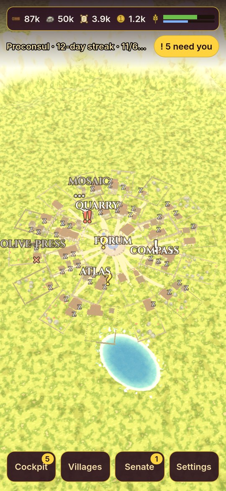
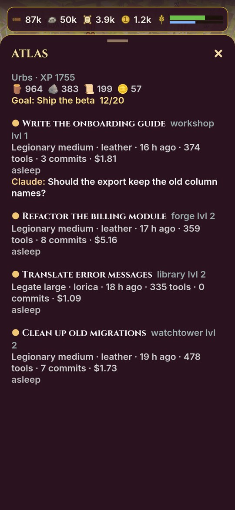
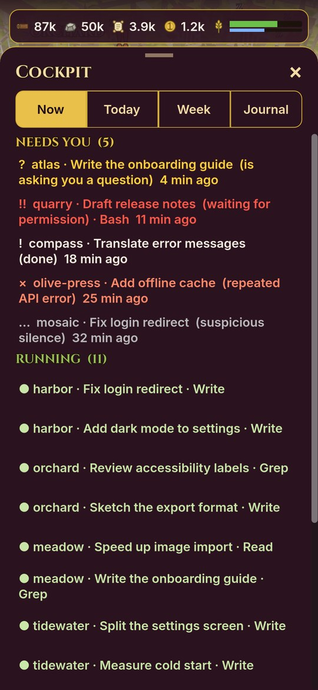
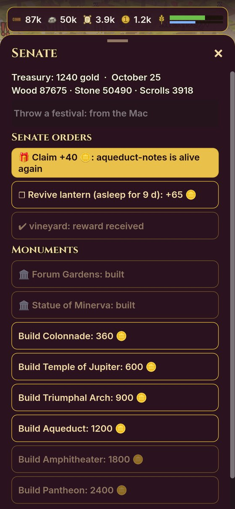
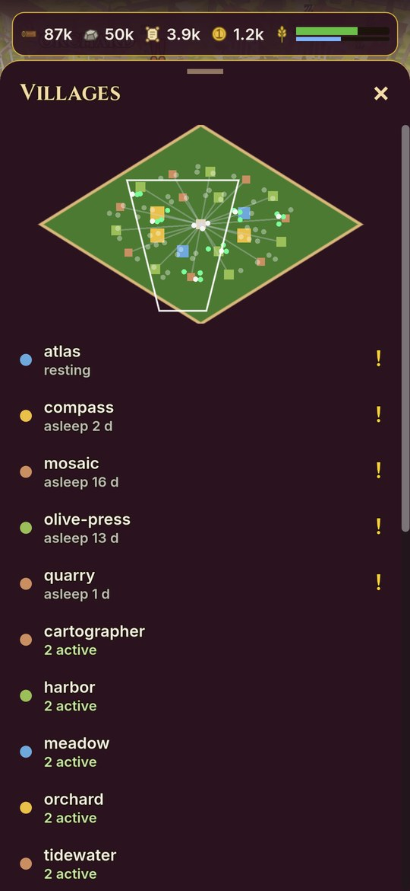
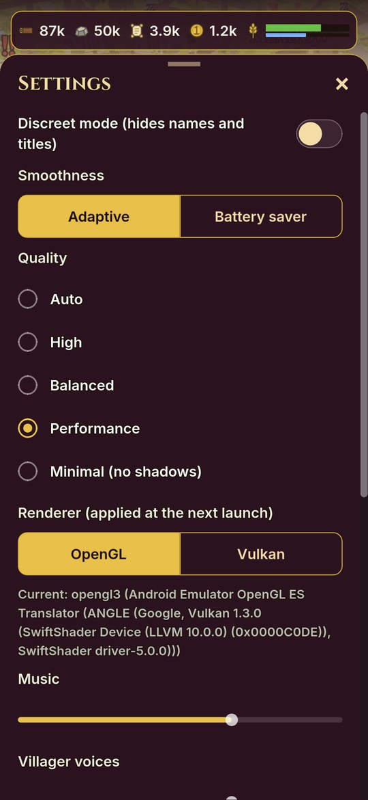
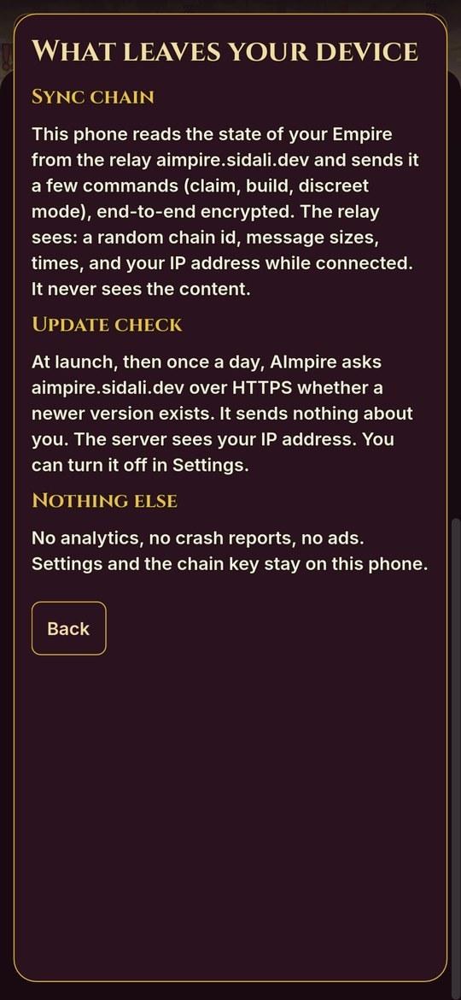
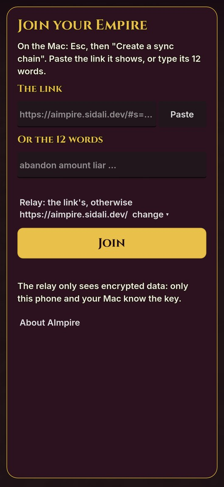

# AImpire

Your Claude Code sessions as a Greco-Roman city: every project folder is a village, every session a building, every
agent a villager.

Community project, not affiliated with Anthropic.

<p>
  
  
  
  
</p>
<p>
  
  
  
  
</p>

Screenshots of the Android app with an invented demo Empire. More in `docs/screenshots/android/`.

## Principles

- **Read-only.** AImpire reads the session logs in `~/.claude/projects` and never writes, moves or erases anything there.
- **Zero tokens.** It never sends a request to a model and never starts or drives a session. Watching costs nothing.
- **Local.** Everything is computed on your Mac, by a small server that listens on 127.0.0.1 only.
- **Encrypted sync.** The phone, if you pair one, sees your Empire through a relay that only holds end-to-end encrypted
  blobs.
- **No account.** No sign-up, no analytics, no crash reports, no ads.

## Install

### Mac (Apple Silicon)

1. Download `AImpire-<version>-macos.zip` and `AImpire-<version>-macos.zip.sha256` from the
   [latest release](https://github.com/sidalidev/aimpire/releases/latest).
2. Check the download, in the folder that holds both files:

   ```bash
   shasum -a 256 -c AImpire-*-macos.zip.sha256
   ```

3. Unzip, move `AImpire.app` to `/Applications`, then, once, remove the quarantine flag (the app is signed ad hoc, not
   notarized, as there is no Apple Developer ID yet):

   ```bash
   xattr -dr com.apple.quarantine /Applications/AImpire.app
   ```

4. Open AImpire. The local server starts and stops with the game. The first scan of your sessions can take a few
   minutes; with no Claude Code session yet, the Empire stays empty until you use Claude Code.

Intel Macs, Linux and Windows have no package for now.

Using Claude Code yourself? `skills/install-aimpire/SKILL.md` is a skill that walks through these steps with you.

### Android

With [Obtainium](https://github.com/ImranR98/Obtainium):

1. Add an app with the source URL `https://github.com/sidalidev/aimpire`.
2. Set the APK filter to `aimpire-.*\.apk`.
3. Install. Obtainium then follows new releases.

Check the signing certificate before the first install: its SHA-256 is in `SECURITY.md`
(`79:E3:7E:06 ... 6E:9E:A0`), and the app shows it too in Settings, About AImpire. You can also download the APK from the
release page and open it on the phone.

The phone is a window on the Mac: pair it from the Mac (see "Sync and relay").

### Updates

The game checks `https://aimpire.sidali.dev/update.json` at launch and then once a day. When a newer version exists, an
"Update" button appears: on the Mac it downloads the zip, checks its SHA-256 and shows it in Finder; on Android it
downloads the APK, which Android installs only if it is signed with the same certificate. Turn it off in Settings,
"Check for updates". On Android, Obtainium does the same from the GitHub releases.

## Voices (optional)

The villagers can speak short lines ("To work!", "Done."). These voices are not in the repository: they are synthesized
with ElevenLabs, so you generate them with your own key when you build from source:

```bash
ELEVENLABS_API_KEY=your-key node tools/gen-voices.mjs
```

The key can also sit in `~/Library/Application Support/AImpire/.env`. The files land in `godot/assets/voix/` (ignored
by git); run `godot --headless --path godot --import`, and your next build carries them. Without them the game is the
same, the villagers only show their speech bubble. See `ASSETS.md`.

"Detailed voices" is a separate setting, off by default: with your own key in
`~/Library/Application Support/AImpire/.env` (`ELEVENLABS_API_KEY=...` and `AIMPIRE_VOIX=1`), a villager reads the start
of a session's latest message aloud. That text goes to ElevenLabs (`PRIVACY.md`).

## Sync and relay

```
Mac (daemon/sync.js) --PUT encrypted state--> relay (relay/) <--GET /blob?wait=25-- phone (godot/mobile.gd)
                     <--GET encrypted commands--             <--POST /cmd----------
```

- On the Mac: Esc, "Create a sync chain". The secret (QR code, link, 12 words) stays hidden behind "Show the secret", hides
  again after 60 s and is never shown in discreet mode.
- On the phone: paste the link or type the 12 words.
- The phone can do three things only: claim a reward, build a monument, switch discreet mode.
- Discreet mode (H) sends an allowlisted state, without names, paths, titles or journal (`daemon/blur.js`).
- Cryptography: a 128-bit secret drawn by the Mac, keys derived with HKDF-SHA256, AES-256-CBC then HMAC-SHA256. The
  relay never sees the secret or the content. Protocol, routes and threat model: `docs/SYNC.md` and
  `docs/THREAT_MODEL.md`.

**Default relay.** `https://aimpire.sidali.dev/`, run by the developer with the code in `relay/`. It only sees a random
chain id, encrypted blobs, their sizes and times, and your IP address while connected.

**Your own relay.** `relay/` is a single Node 22 file with no dependencies:

```bash
PORT=7701 AIMPIRE_RELAY_DATA=/var/lib/aimpire-relay node relay/server.js
```

or with Docker behind Traefik: `deploy/relay-compose.yml` (set `AIMPIRE_RELAY_HOST`). Serve it over HTTPS. Then:

- on the Mac, before "Create a sync chain", replace the "Relay address" with yours (`https://relay.example.org/`).
  The pairing link then points to your relay;
- on the phone, a pasted link carries the relay with it; with the 12 words, open "Relay" on the pairing screen and enter
  the same address.

## Build from source

Requirements:

- macOS on Apple Silicon (the release scripts use zsh, `codesign` and `ditto`)
- [Node.js](https://nodejs.org) 22 or later
- [Godot](https://godotengine.org) 4.7.2 (`brew install --cask godot`) and its export templates (Editor, Manage Export
  Templates, Download and Install)
- [Bun](https://bun.sh) (`brew install oven-sh/bun/bun`), to compile the server embedded in the Mac app
- For Android: JDK 21 (`brew install openjdk@21`), the Android SDK with platform tools and build tools (Android Studio,
  or `sdkmanager "platform-tools" "build-tools;35.0.0"`), and `JAVA_HOME` and `ANDROID_HOME` set

Run in development:

```bash
./aimpire.sh        # local server (127.0.0.1:7777) + game
./aimpire.sh pip    # picture in picture: a small window that stays on top
```

Build:

```bash
AIMPIRE_PUBLIER=0 tools/release-macos.sh     # build/AImpire.app and build/AImpire-<version>-macos.zip
AIMPIRE_PUBLIER=0 tools/release-android.sh   # build/AImpire.apk, signed with a key created in ~/.aimpire/
```

`AIMPIRE_PUBLIER=0` builds without publishing anything. An APK you build is signed with your own key, so Android will
not install it over the official one (uninstall first).

Tests:

```bash
node tools/check-repo.mjs
cd daemon && node --test
cd relay && node --test
godot --headless --path godot -s tests/test_sync_crypto.gd   # and the other godot/tests/test_*.gd
```

Data lives in `~/Library/Application Support/AImpire/` (progress, scan cache, local token, settings, logs). Goals can
be set in `aimpire.json` there (see `aimpire.example.json`). Variables: `AIMPIRE_HOME`, `AIMPIRE_PORT`, `AIMPIRE_LOG`.

Keys on the Mac: Tab cockpit, R daily summary, W weekly report, J journal, H discreet mode, P picture in picture,
M music, Esc settings.

## Privacy

`PRIVACY.md` lists everything that can leave your device: the update check, the sync chain if you create one, and the
detailed voices if you turn them on. Nothing else. The same list is in the app: Settings, About AImpire, What leaves
your device. "Erase everything" in the same screen removes all AImpire data, never your session logs.

## Security

Report a vulnerability privately: `SECURITY.md`. Threat model: `docs/THREAT_MODEL.md`.

Audit status: **no third-party audit.** Internal reviews by the developer are dated in `docs/security/`.

## Credits

3D models by Kenney and Quaternius, sounds by Kenney and Spring Spring, music by zesona (all CC0), fonts Bricolage
Grotesque, Figtree and Cinzel (OFL), built with Godot and Bun. Full list: `THIRD_PARTY.md` and `ASSETS.md`.

## License

The app (everything except `relay/`) is under the MIT license, see `LICENSE`. The relay (`relay/`) is under the GNU
Affero General Public License v3.0 only, see `relay/LICENSE`. Third-party assets keep their own licenses
(`THIRD_PARTY.md`).

## Disclaimer

Community project, not affiliated with, endorsed by or sponsored by Anthropic. Claude and Claude Code are trademarks of
Anthropic. AImpire only reads the files Claude Code leaves on your Mac.
